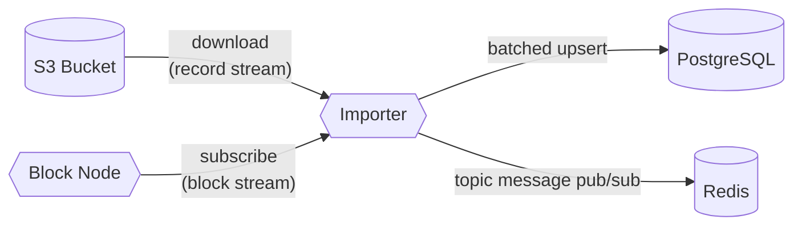
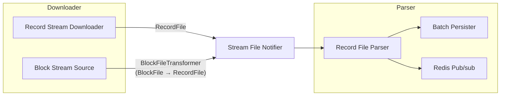

# Importer Architecture

The importer downloads or receives stream files produced by Hedera consensus nodes, cryptographically verifies
them, and ingests the normalized data into PostgreSQL, notifying Redis of new topic messages along the way. It is the
only mirror node component with write access to the database. This document is the entry point into the importer's
architecture; each linked document goes deeper into one part of the system.

## Overview

The importer sits between the network's stream storage and the rest of the mirror node stack. It has two
independent input sources and two outputs:

Only one input is active for a given stream of blocks at a time — see [Block Streams Cutover](docs/importer/cutover.md).
Everything downstream of verification (parsing, persistence, Redis publishing) is shared by both inputs.

## Flow

At a high level, every stream file — regardless of source — passes through the same four stages:

Block streams are translated into the same `RecordFile`/`RecordItem` domain objects used by record streams
_before_ notification, so parsing, persistence, and Redis publishing have no source-specific code paths.

## Detail Documents

| Document                              | Covers                                                                                                                                          |
| ------------------------------------- | ----------------------------------------------------------------------------------------------------------------------------------------------- |
| [Record Streams](record-streams.md)   | Downloading signature/data files from S3-compatible storage, stake-weighted consensus verification, hash-chain validation                       |
| [Block Streams](block-streams.md)     | gRPC subscription to block nodes, file-based block source, node selection, TSS verification, transformation into `RecordFile`                   |
| [Cutover](../cutover.md)              | Detects transition from record streams to block streams and changes the application flow                                                        |
| [Parser](parser.md)                   | Responsible for ... stream file into database rows: item listeners, entity listeners, transaction handlers, batch persistence, Redis publishing |
| [Threading Model](threading-model.md) | Which thread pool runs which stage, the queues connecting them, and the single-instance concurrency assumptions                                 |
