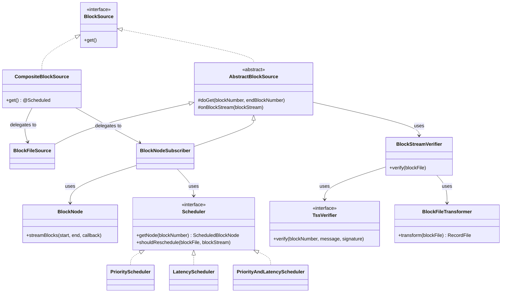
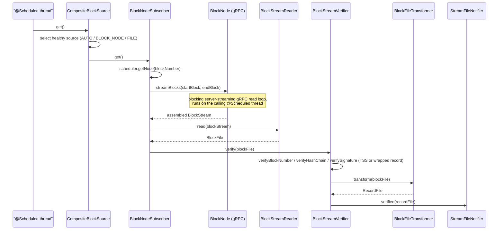

# Block Streams

Block streams are the successor to record streams (see [HIP-1056](https://hips.hedera.com/hip/hip-1056) and
[HIP-1081](https://hips.hedera.com/hip/hip-1081)). A block node exposes blocks over gRPC, each carrying its own
cryptographic proof rather than relying on a separate quorum of signature files. See [Architecture](architecture.md)
for how block streams fit into the overall pipeline and the [cutover](cutover.md) guide for how the importer
switches between record and block streams over time.

## Two Sources, One Selector

Block data can come from either of two sources, chosen by `CompositeBlockSource` based on
`hiero.mirror.importer.block.sourceType`:

- `BlockNodeSubscriber`: A long-lived, pull-initiated gRPC subscription directly to a block node.
- `BlockFileSource`: Block files read from cloud storage, reusing the same `StreamFileProvider` abstraction
  described in [Record Streams](record-streams.md), just pointed at a S3 bucket. There are no separate signature
  files here — the block itself carries its proof.

`sourceType` is one of `AUTO` (default), `BLOCK_NODE`, or `FILE`. In `AUTO`:

- If no block stream bucket is configured for the network (and no `LOCAL` source exists), only `BlockNodeSubscriber`
  is used.
- If no block nodes are known (configured or discovered), `BlockFileSource` is used.
- Otherwise `BlockNodeSubscriber` is preferred. After 3 consecutive errors on the active source, it switches to the
  other one and increments the `hiero.mirror.importer.block.failover` metric when falling back to cloud storage. A
  successful `get()` resets the error count.

## Node Selection

When multiple block nodes are available, `BlockNodeSubscriber` asks a `Scheduler` which node to subscribe to:

- `PriorityScheduler` — orders nodes by configured `priority`.
- `LatencyScheduler` — orders nodes by measured latency (`LatencyService` periodically probes nodes in the
  background).
- `PriorityAndLatencyScheduler` (default, `SchedulerType.PRIORITY_THEN_LATENCY`) — groups by priority tier, then
  orders by latency within a tier.

`Scheduler.getNode(blockNumber)` returns a `ScheduledBlockNode` (the `BlockNode` plus the next block number to
request, or `-1` for the earliest available block), skipping inactive nodes and nodes that don't have the block.
After each block, `shouldReschedule(blockFile, blockStream)` can tell the subscriber to drop the current
subscription and reselect. The latency-aware schedulers record the latency of every block and only reschedule when
the current node is slower than a candidate by `rescheduleLatencyThreshold`, no more often than
`minRescheduleInterval`, and ignoring samples taken while post-processing is slower than `maxPostProcessingLatency`.
`LatencyService` probes candidate nodes in the background (`BlockNode.probeBlock`) with backoff on failure. A node
that repeatedly fails is deactivated and readmitted after `readmitDelay`.

`BlockNodeDiscoveryService` merges statically configured nodes (`BlockProperties.nodes`) with nodes discovered from
registered nodes in the database when `autoDiscoveryEnabled`. Only tier 1 block nodes (advertising `PUBLISH` plus
`STATUS` and `SUBSCRIBE_STREAM`, on one endpoint or two) are used. Discovered nodes override configured ones with the
same endpoints, and the cached result is invalidated on `RegisteredNodeChangedEvent`.

## Verification & Transformation

`BlockStreamVerifier` plays the same role `Downloader` plays for record streams:

1. `verifyBlockNumber` — for a wrapped record block, the block header number must match the wrapped record file's
   index; the number must be consecutive with the last processed record/block file and match the filename.
2. `verifyHashChain` — after a block, the previous hash must match the last block's hash and wrapped record blocks
   are rejected. After a record file, a wrapped record block must chain to the record file hash and (when known) the
   previous wrapped record block hash; the first TSS block after cutover records the previous wrapped record block
   hash and chains to the last record file hash.
3. `verifySignature`:
   - **TSS blocks** — a TSS (threshold signature scheme) `TssVerifier` check of the block root hash against the
     ledger id. The proof is either a `SignedBlockProof` (root hash is the block hash) or a `BlockStateProof` (root
     hash computed by `BlockStateProofHasher` from the merkle paths). The ledger id comes from a
     `LedgerIdPublication` transaction in block 0, the database, or configuration (`initialLedgerIdPublication`).
   - **Wrapped record blocks (WRB)** (cutover) — verifies the `SignedRecordFileProof` node RSA signatures through
     `NodeSignatureVerifier`. Amended files, initial state, and pre-v6 record files are rejected.

On success, `BlockFileTransformer` converts the verified `BlockFile` into a `RecordFile` (a wrapped record block
simply yields its embedded record file; otherwise transactions are processed in reverse order to reconstruct
intermediate state such as running token supply and newly created entity ids), using per-transaction-type
transformers (`BlockTransactionTransformerFactory` → e.g. `ConsensusSubmitMessageTransformer`,
`ContractCreateTransformer`, `TokenMintTransformer`; unlisted types use `DefaultTransformer`) that synthesize an equivalent `TransactionRecord` for each
transaction. From that point on, block-stream data is indistinguishable from record-stream data to the rest of the
pipeline — see [Parser](parser.md#block-stream-convergence).

## Key Classes

| Class                                                                                  | File                                                                                | Responsibility                                                                                   |
| -------------------------------------------------------------------------------------- | ----------------------------------------------------------------------------------- | ------------------------------------------------------------------------------------------------ |
| `BlockSource` / `AbstractBlockSource`                                                  | `importer/.../downloader/block/AbstractBlockSource.java`                            | Template: compute next block number, delegate to a source, read + verify + transform the result. |
| `BlockFileSource`                                                                      | `importer/.../downloader/block/BlockFileSource.java`                                | Pull, cloud-storage-based block source (parallel in spirit to `RecordFileDownloader`).           |
| `BlockNodeSubscriber`                                                                  | `importer/.../downloader/block/BlockNodeSubscriber.java`                            | Pull-based gRPC streaming subscription to a block node.                                          |
| `BlockNode`                                                                            | `importer/.../downloader/block/BlockNode.java`                                      | gRPC client: status/available-range (unary) and block subscription (server-streaming).           |
| `CompositeBlockSource`                                                                 | `importer/.../downloader/block/CompositeBlockSource.java`                           | `@Scheduled` entry point; selects and health-checks between the two sources.                     |
| `Scheduler` (+ `PriorityScheduler`, `LatencyScheduler`, `PriorityAndLatencyScheduler`) | `importer/.../downloader/block/scheduler/*.java`                                    | Chooses which block node to subscribe to.                                                        |
| `BlockNodeDiscoveryService`                                                            | `importer/.../downloader/block/BlockNodeDiscoveryService.java`                      | Merges static + DB-discovered block nodes.                                                       |
| `BlockStreamVerifier`                                                                  | `importer/.../downloader/block/BlockStreamVerifier.java`                            | Verifies block number, hash chain, and cryptographic proof (TSS or consensus).                   |
| `TssVerifier` (`.../block/tss/`)                                                       | `importer/.../downloader/block/tss/TssVerifierImpl.java`                            | Verifies TSS signatures against the ledger id (on-chain, database, or configured).               |
| `BlockStateProofHasher`                                                                | `importer/.../reader/block/hash/BlockStateProofHasherImpl.java`                     | Computes the block root hash from a `BlockStateProof`'s merkle paths.                            |
| `CutoverService`                                                                       | `importer/.../downloader/block/cutover/CutoverServiceImpl.java`                     | Tracks the last record/block file and next block number; switches record ↔ block streams.        |
| `BlockFileTransformer` (+ `BlockTransactionTransformerFactory`)                        | `importer/.../downloader/block/BlockFileTransformer.java`, `.../transformer/*.java` | Converts a verified `BlockFile` into a `RecordFile`/`RecordItem` list.                           |

### Class Diagram

## Sequence Diagram

The gRPC call is a **long-lived, pull-initiated server-streaming call**, not a push callback: the importer opens a
`SubscribeStreamRequest` with a start/end block number and reads responses in a blocking loop on the same thread that
invoked `CompositeBlockSource.get()` (see [Threading Model](threading-model.md)) until it decides to reschedule or the
range ends.

## Configuration

- `BlockProperties` (`hiero.mirror.importer.block.*`, `importer/.../downloader/block/BlockProperties.java`) —
  `enabled` (default false), `sourceType`, `frequency` (default 500ms), `bucketName`, `autoDiscoveryEnabled`
  (default true), `nodes[]`, `initialLedgerIdPublication`, `persistBytes`, `writeFiles`, `stream`.
- `BlockNodeProperties` (`importer/.../downloader/block/BlockNodeProperties.java`) — per-node `priority` and
  `endpoints[]` (`host`, `port` default 40840, `requiresTls`, `apis`). Each node needs both `STATUS` and
  `SUBSCRIBE_STREAM` APIs.
- `StreamProperties` (`hiero.mirror.importer.block.stream.*`,
  `importer/.../downloader/block/StreamProperties.java`) — gRPC tuning: `maxAttempts`, `maxBlockItems`,
  `maxBlockSize`, `maxStreamResponseSize`, `maxDrainAttempts`, `readmitDelay`, `responseTimeout`, `shutdownTimeout`,
  `keepAliveTime`/`keepAliveTimeout`/`keepAliveWithoutCalls`.
- `SchedulerProperties` (`hiero.mirror.importer.block.scheduler.*`,
  `importer/.../downloader/block/scheduler/SchedulerProperties.java`) — `type`, `minRescheduleInterval` (10s),
  `rescheduleLatencyThreshold` (50ms), `maxPostProcessingLatency` (1s).
- `LatencyServiceProperties` (`hiero.mirror.importer.block.scheduler.latency.*`) — background probing: `frequency`
  (10s), `timeout` (5s), `backlog`, `maxBackoff`.
