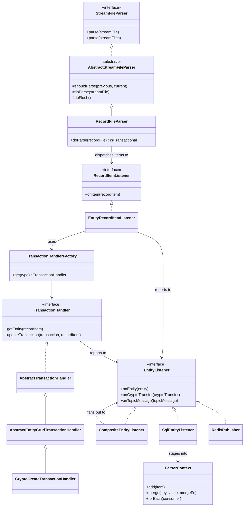
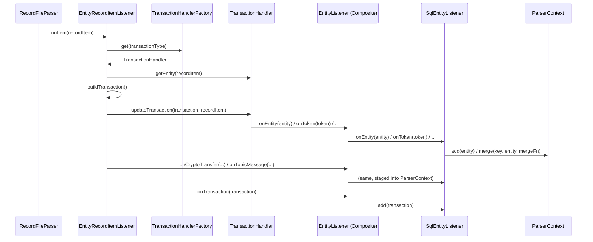
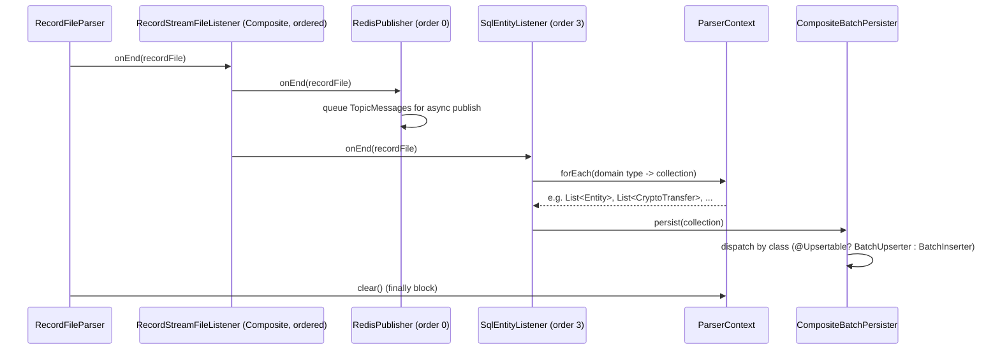
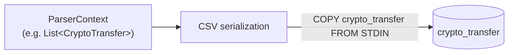
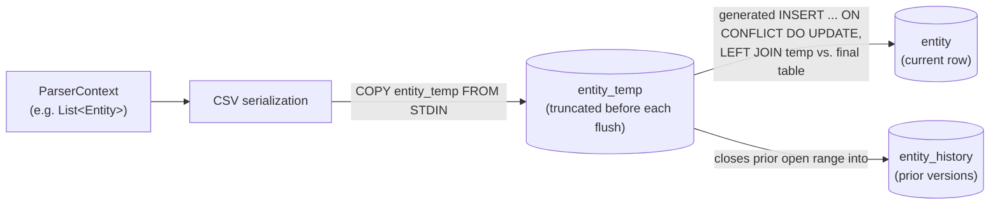

# Parser

Once a stream file is verified (by either [record streams](record-streams.md) or [block streams](block-streams.md)),
the parser turns it into database rows and Redis notifications. This is the layer with the most moving parts, so this
document leans heavily on sequence diagrams. See [Architecture](architecture.md) for how parsing fits into the
overall pipeline.

> `docs/design/parser.md` is an early, pre-implementation design proposal and is out of date (class names and
> signatures no longer match the code). Treat this document as current; that one as historical background only.

## Flow Overview

1. `RecordFileParser` receives a verified `RecordFile` (or a batch of them) and, inside a single DB transaction,
   iterates its `RecordItem`s.
2. Each `RecordItem` is dispatched to `EntityRecordItemListener.onItem()`, which looks up the `TransactionHandler` for
   that transaction type, builds the base `Transaction` row, and lets the handler populate type-specific fields.
3. Both `EntityRecordItemListener` and the transaction handlers report every entity they touch (accounts, tokens,
   topics, transfers, contract results, ...) through the shared `EntityListener` interface — they never talk to the
   database directly.
4. `SqlEntityListener`, one of several `EntityListener` implementations, stages everything into an in-memory
   `ParserContext` for the duration of the file/batch.
5. At the end of the file (or batch of files), `SqlEntityListener.onEnd()` flushes `ParserContext` to PostgreSQL via
   `BatchPersister`, one batched write per domain type. `RedisPublisher`, a separate `EntityListener`, independently
   queues topic messages for asynchronous publication to Redis.

## Item & Entity Listener Concept

- `StreamItemListener<T extends StreamItem>` is the generic "process one item" interface; `RecordItemListener`
  specializes it to `RecordItem` — a Hedera `Transaction` plus its `TransactionRecord` (real for record streams,
  synthesized for block streams) + parent/child links.
- `EntityRecordItemListener` is the sole production `RecordItemListener`. It resolves the `TransactionHandler`, builds
  the `Transaction` row, inserts transfers/fees/signatures, and finally reports the transaction itself — all through
  `EntityListener`.
- `EntityListener` is a large interface of default no-op methods, one per domain type (`onEntity`, `onToken`,
  `onCryptoTransfer`, `onTopicMessage`, ...). It is the single seam between "what happened in this transaction" and
  "what do we do about it" — persistence, Redis, and derived lookups are all just different `EntityListener`
  implementations, fanned out by `CompositeEntityListener` (`@Primary`, `@Order`ed):

  | Order | Listener                           | Role                                                   |
  | ----- | ---------------------------------- | ------------------------------------------------------ |
  | 0     | `RedisPublisher`                   | Queues topic messages for async publish to Redis       |
  | 2     | `SyntheticLogListener`             | Resolves synthetic contract-log entity aliases         |
  | 3     | `SqlEntityListener`                | Stages rows into `ParserContext` for batch persistence |
  | 4     | `TopicMessageLookupEntityListener` | Builds `TopicMessageLookup` partition-range rows       |

## Transaction Handlers

One `TransactionHandler` implementation exists per `HederaFunctionality` (~70 total), registered via
`@Named` and collected by `TransactionHandlerFactory` into a `Map<TransactionType, TransactionHandler>`
(falling back to `UnknownDataTransactionHandler`). `AbstractTransactionHandler.updateTransaction()` is a template
method: it adds common entity IDs, calls the subclass's `doUpdateTransaction()` hook, then `updateEntity()`.
`AbstractEntityCrudTransactionHandler` further specializes this for CRUD-style handlers (create/update/delete an
`Entity` row based on the transaction type), delegating field population to `doUpdateEntity()`. For example,
`CryptoCreateTransactionHandler` reads the new `AccountID` from the receipt and sets alias/key/staking fields;
`ConsensusCreateTopicTransactionHandler` builds both an `Entity` and a `Topic` row.

## Class Diagram

## Sequence Diagram: Per-Item Processing

## Sequence Diagram: End-of-File Flush

## Batch Persistence

`CompositeBatchPersister` picks a `BatchPersister` per domain class, caching the choice: plain `BatchInserter` for
ordinary tables, or `BatchUpserter` for classes annotated `@Upsertable` (entities that need conflict-aware merge/history
semantics, e.g. `Entity`, `Token`, `Nft`).

**Insert-only tables** (e.g. `transaction`, `crypto_transfer`, `topic_message`) are append-only, so `BatchInserter`
serializes the collection to CSV and streams it straight into the final table with a single Postgres
`COPY ... FROM STDIN WITH CSV`:

**Upsertable, history-tracked tables** (e.g. `entity`, `token`, `nft`) instead go through a two-step COPY-then-upsert,
because a single flush may need to both update the current row and close off a prior history range:

`BatchUpserter.persistItems()` truncates the `<table>_temp` table, `COPY`s the batch into it (reusing `BatchInserter`'s
CSV logic), then executes one generated SQL statement (`UpsertQueryGenerator.getUpsertQuery()`, built by
`GenericUpsertQueryGenerator` from a Velocity template — `upsert.vm` for non-history entities, `upsert_history.vm` for
history-tracked ones). For history entities the generated SQL LEFT JOINs the temp table against the current table,
computes coalesced column values, closes the previous row's timestamp range into `<table>_history`, and
`INSERT ... ON CONFLICT (...) DO UPDATE`s the still-open row into `<table>` — all in one statement, no separate
`UPDATE`.

A targeted mid-file flush also exists: `SqlEntityListener.onNftTransferList()` calls `flushNftState()` when it
detects an NFT treasury-change wildcard transfer, forcing `Token`/`TokenAccount`/`Nft` to persist early so a
subsequent `nftRepository.updateTreasury(...)` SQL statement sees consistent state.

## Transactional Boundaries & Idempotency

- `RecordFileParser.parse(RecordFile)` / `parse(List<RecordFile>)` are `@Transactional` and `synchronized` — the
  entire per-file (or per-batch) parse, entity accumulation, and final flush happen in one DB transaction, and are
  `@Retryable` on failure (excluding `OutOfMemoryError`).
- `AbstractStreamFileParser.shouldParse(previous, current)` skips files whose consensus range is already covered by
  the last processed file — the durable idempotency marker is simply "what's the latest persisted `RecordFile`/
  `BlockFile` row" (`StreamFileRepository.findLatest()`), not a separate status flag.
- If the previous file's hash doesn't match the new file's `previousHash`, `shouldParse()` throws
  `HashMismatchException`, aborting the parse.
- `ParserContext` is cleared in a `finally` block after every `parse()` call, so a retried parse starts clean.

## Block Stream Convergence

Everything on this page applies identically whether the `RecordFile` came from a record stream or was produced by
`BlockFileTransformer` from a block stream (see [Block Streams](block-streams.md)) — there is no separate entity
listener chain or persistence path for block-stream data.
