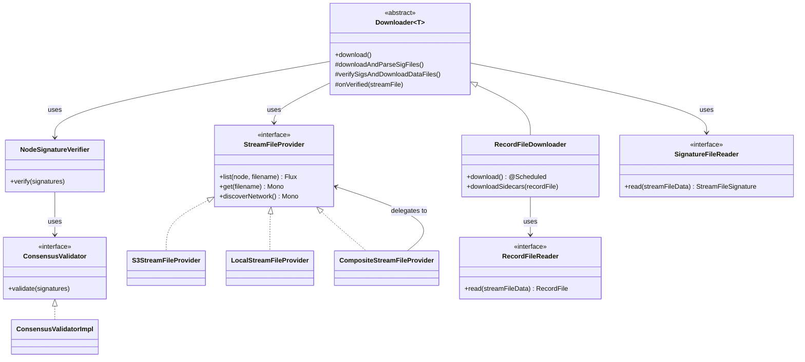
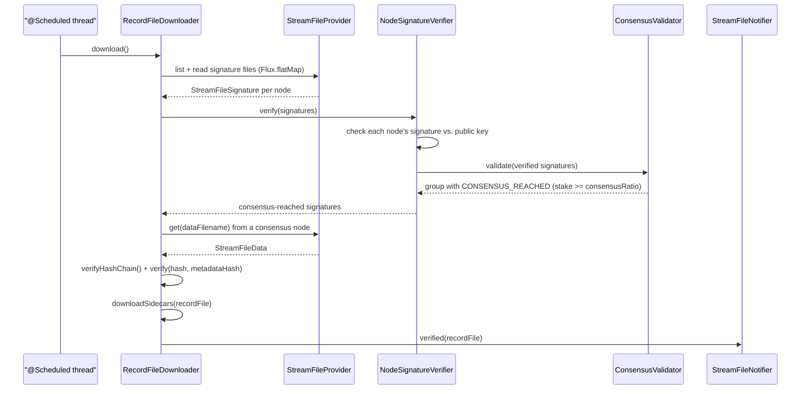

# Record Streams

Record streams are the original ingestion path: consensus nodes independently upload record files (transactions +
results) and signature files to an S3-compatible bucket, and the importer must reassemble which files to trust from
possibly-conflicting or missing node uploads. See [Architecture](architecture.md) for how this fits into the overall
pipeline.

## Flow Overview

1. **List & download signature files** for a random, stake-weighted subset of consensus nodes, in parallel.
2. **Verify each node's signature** against that node's public key (from the address book) and its claimed file hash.
3. **Reach consensus**: group signatures by the file hash they attest to, and accept a hash once the summed stake of
   agreeing nodes reaches `consensusRatio` (default 1/3) of total network stake.
4. **Download the data file** itself from one node in the consensus-reached group.
5. **Verify the hash chain**: the new file's `previousHash` must equal the hash of the last file the importer
   accepted, and the computed file/metadata hashes must match what the signature file asserted.
6. **Download sidecar files** (contract bytecode, state changes, etc.) referenced by the record file, hash-verifying
   each.
7. Hand the verified `RecordFile` off to parsing via `StreamFileNotifier.verified()`.

## Key Classes

| Class                                                                                                            | File                                                                | Responsibility                                                                                                                                         |
| ---------------------------------------------------------------------------------------------------------------- | ------------------------------------------------------------------- | ------------------------------------------------------------------------------------------------------------------------------------------------------ |
| `Downloader<T, I>`                                                                                               | `importer/.../downloader/Downloader.java`                           | Abstract base shared by record and balance downloaders; orchestrates list → verify → download → hash-chain-check → notify.                             |
| `RecordFileDownloader`                                                                                           | `importer/.../downloader/record/RecordFileDownloader.java`          | Concrete `Downloader` for record files; `@Scheduled` entry point (default every 500ms); also downloads sidecars.                                       |
| `NodeSignatureVerifier`                                                                                          | `importer/.../downloader/NodeSignatureVerifier.java`                | Verifies each node's cryptographic signature over the file hash (and metadata hash) using the node's public key.                                       |
| `ConsensusValidator` / `ConsensusValidatorImpl`                                                                  | `importer/.../downloader/ConsensusValidator*.java`                  | Groups verified signatures by asserted hash, sums stake per group, and requires ≥ `consensusRatio` of total stake to mark a group `CONSENSUS_REACHED`. |
| `StreamFileProvider`                                                                                             | `importer/.../downloader/provider/StreamFileProvider.java`          | Reactive interface (`list`, `get`, `discoverNetwork`) abstracting the storage backend.                                                                 |
| `S3StreamFileProvider`                                                                                           | `importer/.../downloader/provider/S3StreamFileProvider.java`        | AWS SDK v2 `S3AsyncClient`-based implementation; works for both AWS S3 and GCS (via endpoint override).                                                |
| `CompositeStreamFileProvider`                                                                                    | `importer/.../downloader/provider/CompositeStreamFileProvider.java` | `@Primary` provider wrapping multiple configured sources, retrying/failing over between them with per-source health tracking.                          |
| `LocalStreamFileProvider`                                                                                        | `importer/.../downloader/provider/LocalStreamFileProvider.java`     | Filesystem-backed provider for local/dev use.                                                                                                          |
| `RecordFileReader` (+ `CompositeRecordFileReader`, `RecordFileReaderImplV1/V2/V5`, `ProtoRecordFileReader`)      | `importer/.../reader/record/*.java`                                 | Parses raw bytes into a `RecordFile` domain object; dispatches by file version/magic byte.                                                             |
| `SignatureFileReader` (+ `CompositeSignatureFileReader`, `SignatureFileReaderV2/V5`, `ProtoSignatureFileReader`) | `importer/.../reader/signature/*.java`                              | Parses raw bytes into a `StreamFileSignature`.                                                                                                         |
| `SidecarFileReader` / `Impl`                                                                                     | `importer/.../reader/record/sidecar/*.java`                         | Parses and hash-verifies sidecar files.                                                                                                                |

### Class Diagram

## Sequence Diagram

## Configuration

- `CommonDownloaderProperties` (`hiero.mirror.importer.downloader.*`, `importer/.../downloader/CommonDownloaderProperties.java`)
  — `consensusRatio` (default 1/3), `downloadRatio`, `batchSize`, `maxSize`, `sources[]` (one or more backing
  `StreamSourceProperties`), `timeout`.
- `RecordDownloaderProperties` (`hiero.mirror.importer.downloader.record.*`,
  `importer/.../downloader/record/RecordDownloaderProperties.java`) — `enabled`, `frequency` (default 500ms),
  `writeFiles`, `writeSignatures`, `persistBytes`.

For historical ingestion tuning of these properties, see [`README.md`](README.md#historical-data-ingestion).
