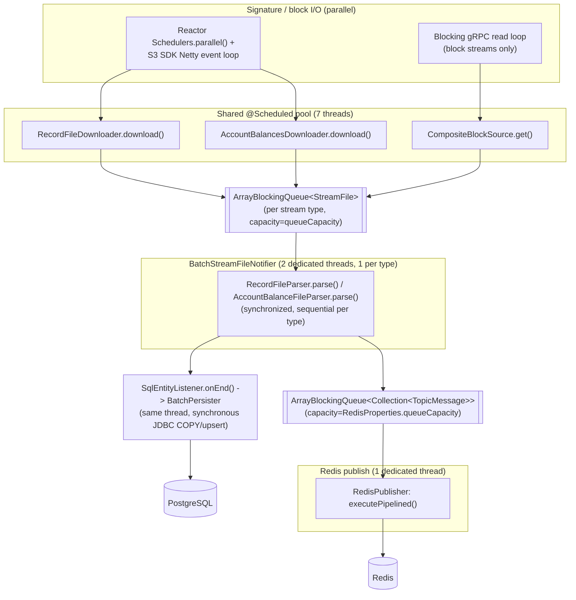

# Threading Model

The importer is designed to run as a **single instance** — there is no distributed-locking mechanism anywhere in the
codebase. Mutual exclusion is achieved purely with JVM constructs (`synchronized`, `AtomicReference`, bounded queues) on
the assumption that only one importer process is running per environment. Within that one process, work moves through a
small number of thread pools connected by two explicit queues.

## Thread Pools

| Pool                                                       | Size                                             | File                                                                  | Purpose                                                                                                                                                                              |
| ---------------------------------------------------------- | ------------------------------------------------ | --------------------------------------------------------------------- | ------------------------------------------------------------------------------------------------------------------------------------------------------------------------------------ |
| Spring `@Scheduled` pool                                   | 7 (`spring.task.scheduling.pool.size`)           | `application.yml`                                                     | Runs every `@Scheduled` method: record/balance/block download, latency probing, retention, partition maintenance, reconciliation. Shared — these all compete for the same 7 threads. |
| `BatchStreamFileNotifier` subscribers                      | 2 (fixed)                                        | `downloader/BatchStreamFileNotifier.java`                             | One dedicated thread per stream type (BALANCE, RECORD) that drains a queue of verified files and drives parsing.                                                                     |
| Redis publish executor                                     | 1 (single)                                       | `parser/record/entity/redis/RedisPublisher.java`                      | Drains queued topic-message batches and pipelines them to Redis.                                                                                                                     |
| Block-node channel cleanup executor                        | 1                                                | `downloader/block/scheduler/AbstractScheduler.java`                   | Drains buffered gRPC messages and closes superseded channels when block nodes rotate.                                                                                                |
| Latency-probe executor                                     | 1 + backlog                                      | `downloader/block/scheduler/LatencyService.java`                      | Runs small "measure 1 block" gRPC calls against block nodes to estimate latency, isolated from the main ingestion path.                                                              |
| `transaction_hash` shard executor                          | 8 (Reactor `Schedulers.newParallel`)             | `parser/batch/TransactionHashBatchInserter.java`                      | Shards `TransactionHash` rows and `COPY`s each shard concurrently; invoked synchronously from the parse thread and blocked on.                                                       |
| Reactor `Schedulers.parallel()` + AWS SDK Netty event loop | CPU-core count / `maxConcurrency` (default 1000) | `downloader/Downloader.java`, `config/CloudStorageConfiguration.java` | Parallel per-node signature listing/downloading and general S3 I/O.                                                                                                                  |

## Hand-off Diagram

Two things are easy to miss from the class-level docs but matter for this diagram:

- **The block-node gRPC read loop runs on one of the 7 shared `@Scheduled` threads**, not a separate callback thread —
  `BlockNode` uses a blocking server-streaming gRPC call (`ClientCalls.blockingV2ServerStreamingCall`), so that thread
  stays blocked reading block data for as long as the subscription is open.
- **There are only two real thread boundaries in the whole pipeline**: the download→parse `ArrayBlockingQueue` and
  the parse→Redis `ArrayBlockingQueue`. Everything else (S3 fan-out, the gRPC read loop, the sharded
  `transaction_hash` COPY) is a bounded worker pool doing I/O in parallel and then blocking/joining back onto a
  single scheduling or parse thread.

## Single-Instance Concurrency Points

Since there's no distributed lock, a few `synchronized` blocks stand in for it, scoped to the single JVM:

- `CutoverServiceImpl.get(StreamType, Runnable)` — used by both `RecordFileDownloader.download()` and
  `CompositeBlockSource.get()`, both scheduled on the same 7-thread pool; ensures the record and block download paths
  never run concurrently against shared cutover state.
- `RecordFileParser.parse(...)` / `AccountBalanceFileParser.parse(...)` — guards against re-entrancy/overlap, even
  though in practice only one dedicated consumer thread per stream type ever calls it.
- `RetentionJob.prune()`, `PartitionMaintenance.runMaintenance()`, `BalanceReconciliationService.reconcile()` — each
  `synchronized` to prevent a run overlapping itself if it overruns its own scheduling interval.

## Configuration

- `spring.task.scheduling.pool.size` (`application.yml`) — size of the shared `@Scheduled` pool.
- `AbstractParserProperties.BatchProperties` (`parser/AbstractParserProperties.java`) — `queueCapacity`, `maxFiles`,
  `maxItems`, `window`, `flushInterval`: governs the download→parse queue and batching behavior.
- `RedisProperties` (`parser/record/entity/redis/RedisProperties.java`) — `queueCapacity` for the parse→Redis queue.
- `StreamSourceProperties.maxConcurrency` (`downloader/StreamSourceProperties.java`) — bounds concurrent S3
  connections.
- `LatencyServiceProperties` (`downloader/block/scheduler/LatencyServiceProperties.java`) — `backlog`, `frequency`
  for the latency-probe executor.
